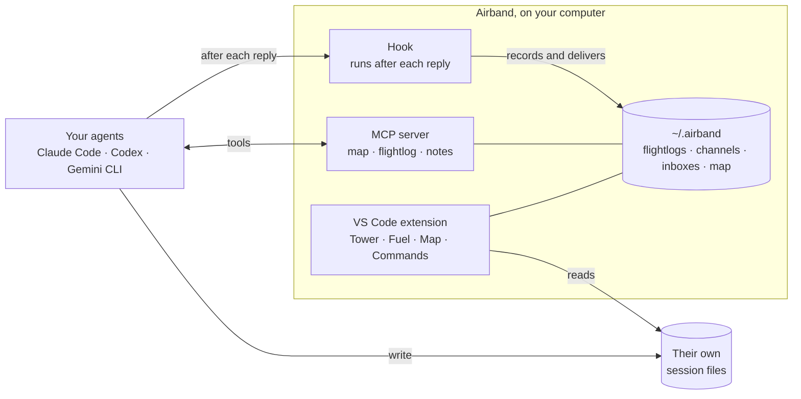
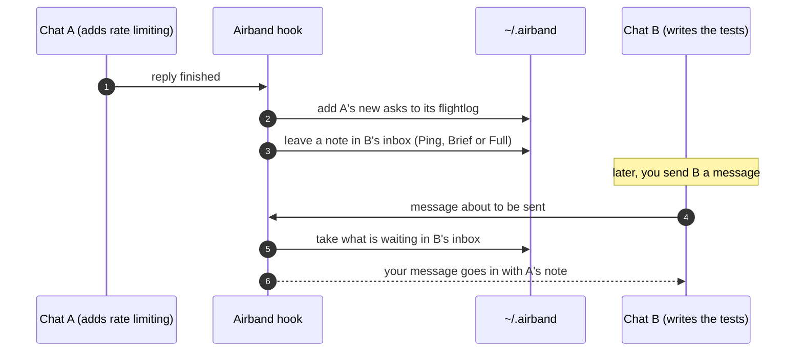

<h1 align="center">
  <picture>
    <source media="(prefers-color-scheme: dark)" srcset="media/airband-wordmark-dark.png">
    
  </picture>
</h1>

<p align="center">
  <strong>Connect your Claude Code, Codex and Gemini CLI chats, so each one knows what the others did.</strong>
</p>

<p align="center">
  <a href="https://github.com/HarshBaldaniya/airband/actions/workflows/test.yml"></a>
  <a href="https://www.npmjs.com/package/airband"></a>
  <a href="LICENSE"></a>
  
</p>

<p align="center">
  <a href="#quick-start">Quick start</a> ·
  <a href="#what-you-get">What you get</a> ·
  <a href="#how-it-works">How it works</a> ·
  <a href="#install">Install</a> ·
  <a href="#the-airband-command">Command line</a> ·
  <a href="#privacy-and-security">Privacy</a> ·
  <a href="#troubleshooting">Troubleshooting</a>
</p>

---

## Why Airband

You run several AI coding chats at once: one builds a feature, another writes its tests, a third reviews
the pull request. Each one starts blind to what the others just did, so you copy and paste between them,
or explain the same thing three times.

Airband links those chats. When a chat finishes a reply, every chat connected to it receives a short
note with its next message: what was asked, what was done and which files changed. It also gives every
agent a map of your code, so finding something costs a few hundred tokens instead of a search through
files.

- **Every agent, one place.** Claude Code, Codex and Gemini CLI, side by side in VS Code.
- **Chats that keep each other informed,** at the level of detail you choose.
- **Local by design.** No server, no account, no AI model of its own, and it never reads a login.

## Quick start

```bash
npx airband
```

That one command finds Claude Code, Codex and Gemini CLI on your computer, sets each one up, and
adds the `airband` command. Every settings file it touches is backed up first.

```text
  Airband 0.0.1  setting up your agents

  ✓ Claude Code   tools · skills · auto-sharing
  ✓ Codex         tools · skills · auto-sharing
  ✓ Gemini CLI    tools · auto-sharing
  ✓ airband       the command, in any new terminal

  Done. Restart open agent chats to pick it up.
```

Then restart your agent chats. Each new chat opens with a line from Airband, shown to you only:

```text
✓ Airband · map of my-app ready (1,284 files) · sharing with “Billing fix” (Codex)
  Another chat worked here in the last 12 hours: “Fix login redirect” (Codex). Say “catch up” to hear what it did.
```

when another chat's work rides along with your message:

```text
↪ Airband added what “Billing fix” (Codex) did to this message
```

and after your agent asks Airband something, what it found and what it saved (Claude Code):

```text
↪ Airband: “syncSeats” and the 4 places that use it · about 300 tokens instead of about 9,800 to read the 5 files
```

The saving is measured, not guessed: the answer's own length against the real size of the files
it points to. It shows only when it is a real saving.

In Codex, type `/hooks` once and trust Airband's hook: Codex runs a new hook only after you approve
it.

## What you get

| | |
|---|---|
| **Tower** | Every chat as a card on one board: its status, model, how full its context is. Drag one card onto another to **connect** them. |
| **Channels** | A connection between two chats, at the level you choose: **Ping** (one line per ask, the default), **Brief** (asked, done, open, files and PRs) or **Full** (the words themselves). One-way or both ways, paused or open. |
| **Flightlog** | A short record of each chat: one line per ask, with what was done, the files, commits and pull requests, and what is still open. |
| **Map** | Your project's parts and files as a board, built by a parser on your computer. Agents query it instead of searching files. TypeScript, JavaScript, Python, Go, Rust, Java, C#, Ruby and PHP. |
| **Commands** | 28 ready-made commands (plan, build, review, pr, tests, specs, recall and more), the same in every agent, plus your own as Markdown files. |
| **Fuel** | Each agent's plan limits as the agent reports them, and tokens per chat. |
| **Writing** | The writing rules agents get, switched on and off; a team file for each project; a file checked on the spot; and what the checks found lately. |

### What your agents get

Setup gives each agent three tools over MCP (under 400 tokens of definitions in all), the
instructions to use them, and 15 skills they pick up by themselves when a task matches.

| Tool | What an agent does with it |
|---|---|
| `airband_map` | `find` code by name or meaning, ranked, with `path:start-end`; `outline` a file or folder; `graph` who uses what; `check` unused code and stale docs; `diff` what a branch or pull request changed; `in` another project you mapped; or an overview of the project |
| `airband_flightlog` | Read another chat's asks and outcomes, or search every chat, by words, code names, tickets (`ENG-142`), PRs (`#128`) or Figma links |
| `airband_notes` | Read and leave notes for the next chat in this project |

Each skill does a job with what only Airband knows: the map of your code, the records of every
chat, and the notes chats leave. You don't call them. Ask for the job in your own words, and the
agent picks the skill. Only a skill's one-line description sits in each chat. The rest loads when
the skill is used.

| For | Skill | Used when you ask to … |
|---|---|---|
| Developers | `airband-find-code` | find where something is, or what uses it |
| | `airband-impact` | know what a change would break, or whether a rename or delete is safe |
| | `airband-review` | review a PR, a branch, or your own changes before a PR |
| | `airband-debug` | find why something is broken (it first checks whether an earlier chat saw it) |
| | `airband-onboard` | explain a codebase to someone new |
| QA | `airband-test-plan` | plan the tests for a PR or feature, starting with the changes no test reaches |
| Product and leads | `airband-progress` | say where a ticket, feature or PR stands |
| | `airband-ticket` | pick up a ticket, issue, PR or Figma link with what was done on it before |
| | `airband-standup` | write a standup or a weekly update from your chats |
| Finance and founders | `airband-spend` | show the tokens spent by project, agent, ticket and chat |
| Everyone | `airband-recall` | find what was done before, and which chat did it |
| | `airband-catchup` | hear what the other chats did while you were away |
| | `airband-handoff` | leave the work so another chat or agent can continue it |
| | `airband-write-docs` | write a PRD, spec, README or PR description no one can misread |
| | `airband-write-messages` | write a Slack post, email or comment people can act on |

If you have your own skill for the same job (your team's review checklist, say), the agent follows
yours and uses Airband's tools inside it.

The commands are there to run by hand too: `/airband:review` in Claude Code, `/prompts:review` in
Codex, `/review` in Gemini CLI.

### Reviewing a pull request

`airband_map` with `diff: "#128"` reads the pull request from git without checking it out. In a
terminal, run `airband diff #128`. It lists every function, class and type the PR added, changed,
moved or removed. Each one has `path:start-end`, its callers and the tests that reach it. Removed
code that something still calls is flagged. A number is fetched from `origin` first. A branch name or `main..feature`
works too. With nothing given, it compares this branch with the default one. Code that only the
removed code used is listed as "Left with no caller".

```text
main...#128 (4f1c2a9e0 → 9b77d03c1): 6 declarations changed in 3 files.
src/billing/seats.ts
  removed oldSeatCount function was :12-30 · still used by 1: invoiceLines src/billing/invoice.ts (check these)
  changed syncSeats function :40-88 · used by 4: onMemberJoined src/team/members.ts, … · tests: test/seats.test.ts
src/team/members.ts
  changed onMemberLeft function :61-79 · used by 2: removeMember src/team/api.ts, … · no test reaches it
```

With `in: "my-api"` (or `--in my-api`), the same questions go to another project you have mapped.
Name it by its folder. A chat in your app can then look up the API route it calls.

### Tickets, issues and designs

Each chat's record keeps the tickets and links named in it. These are Linear and Jira ids
(`ENG-142`), GitHub pull requests and issues (`#128`, links), and Figma files and frames. Ask any agent "what did we do
for ENG-142?" and it finds the chats, in any agent, that worked on it. Airband does not connect to
Linear, GitHub or Figma. It remembers what your chats did with them.

### Writing rules for docs and messages

AI agents now write many of a team's docs and messages. Airband gives them house rules, at the
moment they need them:

| When an agent is asked to … | Airband adds, once per chat |
|---|---|
| write a doc: a PRD, spec, README, guide, PR description or changelog | the **docs rules**: one idea per sentence, active voice, one name for one thing, no hype words, every fact and hedge kept, no lines crediting an AI tool |
| write a message: Slack, email, a PR or ticket comment, an announcement | the **message rules**: the point first, who does what by when, at most 5 items in a list, no empty greetings, no lines crediting an AI tool, a draft before sending |
| reply to you (off by default) | the **reply rules**: the answer or next action first, numbered steps, where things stand, no recap |

The rules are a few lines (about 150 tokens), sent only with an ask that needs them. The full rules
are the `airband-write-docs` and `airband-write-messages` skills. After an agent writes a doc file,
Airband checks the new text. It names long sentences, semicolons, hype words, two-word verbs,
filler, and lines such as "🤖 Generated with …" or "Co-Authored-By: Claude". What agents write goes
out in your name, so it reads as yours. The agent gets the list to fix, and you see one line:

```text
↪ Airband checked docs/prd.md: 2 long sentences (lines 14, 31), 1 hype word (line 9)
```

**Before it goes out.** Before an agent sends a Slack message, an email, a PR description, a
comment or a commit, Airband reads the words. If they break the rules, it holds the send once and
tells the agent what to fix. A commit is held only for a line crediting an AI tool. If the same
words come again unchanged, they go through, so a wording you asked for never gets stuck. This
works in Claude Code and Gemini CLI. In Codex, the rules still come with the ask.

```text
↪ Airband held a Slack message to fix first: 2 empty greetings or sign-offs (line 1)
```

Claude Code adds its own "Co-Authored-By: Claude" line to commits and "Generated with Claude Code"
to PRs, because its built-in instructions tell it to. `airband writing ai-credit off` turns that off
at the source, in Claude Code's own `attribution` setting. Airband backs up the settings file first,
and `ai-credit on` puts back whatever was there.

The **Writing** page in the VS Code extension has a switch for each of these.

```bash
airband writing                       # what is on
airband writing replies on            # short replies in every chat
airband writing before-send off       # don't check messages before they go out
airband writing ai-credit off         # Claude Code stops adding its AI-credit lines
airband writing check docs/*.md       # check files; exits 1 on findings, for CI
airband writing docs on --project     # the team's choice, in .airband.json
```

**For a team:** `--project` writes `.airband.json` at the project's root. Commit it, and everyone
who uses Airband in that project gets the same rules, in every agent. It can carry the team's own
rules too, and they are added after Airband's:

```json
{
  "writing": {
    "docs": true,
    "messages": true,
    "rules": ["Write British English.", "Name the owner of every action item."]
  }
}
```

The project's file wins over each person's setting. Your own writing skills and instructions win
over both. The docs rules follow the ideas of controlled-language writing (ASD-STE100, Simplified
Technical English). The message rules follow ADHD-friendly writing. Both are Airband's own short
versions.

### Standups and AI spend

Airband already keeps a record of every chat in every agent, so it can answer two questions no
single agent can:

```bash
airband standup              # what your chats did yesterday and today, per project
airband standup --days 7     # the week, for a weekly update
airband spend                # tokens in the last 7 days: by project, agent, ticket and chat
airband spend --days 30 --json
```

```text
Since Tue 10 Nov: 3.4B tokens in 17 chats (46k new input, 7.7M output, 3.4B cache reads).

By project
  my-app                      1.8B   54%  8 chats
  my-api                      1.6B   46%  6 chats
```

Ask an agent for "my standup" or "AI spend this month" and it uses these, then writes the update for
you. Tokens are what each agent reported in its own files. Tokens per ticket are an estimate, because
agents report tokens per reply, not per topic.

### A companion on your desktop

The Airband app puts a small companion, Roger, in a corner of your screen. It watches every chat in
Claude Code, Codex and Gemini CLI, so you don't have to check each one.

- **A chat needs you:** Roger hops and shows the request. Click **Allow**, **Always**, **Deny**, or
  pick an answer to the chat's question. The chat carries on.
- **A chat finished:** Roger cheers once and offers **Review**, which opens that chat.
- **Ask him:** "what's happening?", "what did I do today?", "open the billing chat", "tell the API
  chat that the route changed", "allow it", "hide". If he isn't sure which chat you mean, he asks.
- **Move him:** drag him anywhere. Tuck him away small with the **–** button, and click to bring him
  back. Right-click him for the menu, or use ⌥⌘R.

Roger's name and look are settings, so you can call him something else.

```bash
npm run desktop:install      # from a clone of this repository: builds the Mac app, installs it, opens it
```

On first start the app sets up Airband in every agent it finds, so that is the only step. With no
app running, nothing changes: each chat asks in its own terminal, as before. On any computer,
`airband station` gives the same requests and chats in a browser, without the app.

## How it works

Airband sits beside your agents. It reads the session files they already write, keeps its own short
records, and reaches each agent through two standard doors every agent has: a **hook** that runs after
each reply, and an **MCP server** with the tools above.



### When two chats are connected



The note arrives with the next message you were sending anyway, so it costs no extra turn. The words
are fenced and marked as information from another chat, never as instructions.

### What `npx airband` does


Run it again any time: it changes nothing that is already right, and replaces only Airband's own
entries.

## Install

### The command line and every agent

| Package manager | Set up, nothing installed first | Install the command |
|---|---|---|
| npm | `npx airband` | `npm i -g airband` |
| pnpm | `pnpm dlx airband` | `pnpm add -g airband` |
| Yarn | `yarn dlx airband` | `yarn global add airband` (Yarn 1) |
| Bun | `bunx airband` | `bun add -g airband` |

**Requirements:** [Node.js](https://nodejs.org) 20 or newer, and at least one of Claude Code, Codex or
Gemini CLI. Works on macOS (Apple silicon and Intel), Windows 10 and 11, and Linux (x64 and Arm).
Nothing is compiled for your computer.

### VS Code extension

The Tower, Fuel, the Map and Commands live in the extension. It is not on the Marketplace yet;
install it from source:

```bash
git clone https://github.com/HarshBaldaniya/airband.git
cd airband
npm install
npm run install:vscode
```

Then reload VS Code (**Developer: Reload Window**). Needs VS Code 1.95 or newer.

### Claude Code plugin

```text
/plugin install airband --marketplace HarshBaldaniya/airband
```

### Gemini CLI extension

```bash
gemini extensions install https://github.com/HarshBaldaniya/airband --auto-update
```

## The airband command

| Command | What it does |
|---|---|
| `airband` | Show what each agent has, and set up anything missing |
| `airband doctor` | Check that everything works, with the exact fix for anything that doesn't |
| `airband update` | Move to the newest version and refresh every agent (`--check` only looks) |
| `airband remove` | Take Airband out of every agent (`--purge` also deletes its data) |
| `airband notices off` | Hide Airband's lines in your agent's window (`on` shows them again) |
| `airband find "rate limiter"` | Where something is in your code; also `outline`, `graph`, `overview` |
| `airband diff #128` | What a pull request or branch changed: functions, their callers, the tests |
| `airband standup` | What your chats did since yesterday, in every project (`--days 7` for a week) |
| `airband spend` | Tokens spent by project, agent, ticket and chat (`--days 30`) |
| `airband writing` | The writing rules agents get; `writing check <file>` checks a doc |
| `airband changelog` | What changed in this version (`--all` for every version) |
| `airband about` | Version, system, where it is installed, and the links |
| `airband bug` | Open a GitHub issue with your version and system filled in |
| `airband help <command>` | Options and examples for any command |

`status`, `doctor`, `version` and `about` take `--json`. Setup takes `--agents claude,codex`,
`--no-sharing`, `--no-command`, `--completion` and `--verbose`.

<details>
<summary><strong>Tab completion</strong></summary>

Setup asks once whether to turn it on for zsh, bash or fish. For PowerShell, add
`airband completion powershell | Out-String | Invoke-Expression` to your `$PROFILE`.
`airband remove` takes it out again.
</details>

<details>
<summary><strong>Updates</strong></summary>

Airband checks npm for a newer version at most once a day and says so in one line; it never updates
by itself. The check is off in CI, and with `AIRBAND_NO_UPDATE_CHECK=1` or `NO_UPDATE_NOTIFIER=1`.
</details>

<details>
<summary><strong>The Map without VS Code</strong></summary>

For CI and cloud agents:

```bash
airband find "rate limiter"        # ranked matches, path:start-end
airband outline src/api/limits.ts  # one level of a file or folder
airband graph RateLimiter          # who uses it, what it uses
airband diff #128                  # what a PR changed, who calls it, which tests reach it
airband check docs                 # exits 1 when a doc names code that is gone
```

`--in <folder>` points it at another project, and so does the name of one already mapped
(`--in my-api`). The parsers for TypeScript, JavaScript and Python are
built in; Go, Rust, Java, C#, Ruby and PHP are downloaded once, the first time a project has them,
and used only if they match a fingerprint built into Airband.
</details>

## Configuration

Settings live under **Settings → Extensions → Airband**:

| Setting | Default | What it does |
|---|---|---|
| `airband.contextSize` | `"standard"` | How much of a chat another chat receives when they are first connected: `compact` (~2k tokens), `standard` (~6k) or `full` (~15k). The rest is always in its flightlog. |
| `airband.autoDeliver` | `false` | Give waiting updates to a chat as soon as it finishes, at the cost of an extra turn. Off: they wait for your next message, at no extra cost. |
| `airband.codeMap.enabled` | `true` | Keep a Map of each open folder (about 1 MB for a large project). |
| `airband.notices` | `true` | Show Airband's line when a chat starts and when other chats' work is added to your message. Shown to you only; no tokens. |
| `airband.writing.docs` | `true` | Add the docs writing rules when a chat is asked for a doc, and check docs agents write. |
| `airband.writing.messages` | `true` | Add the message writing rules when a chat is asked for a message. |
| `airband.writing.beforeSend` | `true` | Check a message, PR or commit before an agent sends it, and hold it once to fix. |
| `airband.writing.replies` | `false` | Ask every chat for short replies you can act on. |
| `airband.backupFolder` | `""` | A folder to copy flightlogs and your own commands to every half hour, for example in iCloud Drive or Dropbox. |

Without VS Code, the same choices are commands: `airband notices off`, `airband writing replies on`.
A project's `.airband.json` sets the writing rules for everyone who works in it.

<details>
<summary><strong>Keyboard shortcuts</strong></summary>

| Keys | Where | Action |
|---|---|---|
| `T` `U` `M` `C` `E` | Everywhere | Tower, Fuel, Map, Commands, Writing |
| `/` | Tower, Map, Commands | Find a chat, a file or a command |
| `N` | Tower | New Claude chat |
| `1` `2` `3` `4` | Tower | Arrange by channel, time, agent, folder |
| `0` | Tower, Map | Fit everything in view |
| `F` | Tower, Fuel | Focus mode |
| `Esc` | Everywhere | Close, clear or step back |

Press `?` on any page for the full list.
</details>

## Privacy and security

- **The desktop companion sees your chats' records in Airband and nothing else.** It never opens
  your files, folders, screen or clipboard. Asked to, it says so and asks which chat to look in.
- **Look things up is one switch.** With it on (it starts on), the companion passes a question it
  can't answer itself to Claude Code. A question about your chats gets only Airband's read-only
  flightlog. Any other question gets only web search. Neither gets file or shell tools or your other
  connections, and nothing of it is saved as a chat. A question that asks to read your files or
  folders is refused.
- **Permission requests stay on your computer.** The app listens on this computer only, never on
  your network. A phone link will come with Airband's own iPhone app.
- **Nothing is sent anywhere by Airband.** It reads the session files your agents already write and
  keeps its own data in `~/.airband`, readable only by you. No server, no account, no telemetry.
- **Online for two things only:** a daily npm version check, and a language parser the first time a
  project needs one. `AIRBAND_OFFLINE=1` turns both off.
- **Secrets stay out.** API keys, tokens and private keys pasted into a chat are removed before
  anything is recorded, shared or returned by a tool.
- **Shared text is data, not orders.** What one chat sends another is fenced with a random tag and
  marked as information, so words in it can't pass for your instructions.
- **No logins.** Airband never reads a login, token or key file.
- **Standups, spend and the writing check stay on your computer.** They read the records Airband
  already keeps and the files agents write. Nothing is uploaded.
- **Changes only Airband's own entries** in each agent's settings, after a backup; `airband remove`
  takes them all out again.

What one chat shares with another becomes part of the receiving chat, so it goes to that agent's
provider like anything else you type there. To report a vulnerability, see [SECURITY.md](SECURITY.md).

## Troubleshooting

<details>
<summary><strong>Start here: <code>airband doctor</code></strong></summary>

It checks Node.js, Airband's files, and for each agent the tools, the skills and auto-sharing, and
prints the exact fix for anything that isn't right.
</details>

<details>
<summary><strong>A connected chat doesn't receive updates</strong></summary>

Updates arrive with the chat's **next** message, not instantly (unless `airband.autoDeliver` is on).
Check that auto-sharing is on with `airband doctor`. In Codex, type `/hooks` once and trust Airband's
hook.
</details>

<details>
<summary><strong>The Map is empty or out of date</strong></summary>

Run **Airband: Read the code again for the map** in VS Code, or `airband map` in a terminal. The folder
needs code in one of the supported languages.
</details>

<details>
<summary><strong>Plan limits don't show for an agent</strong></summary>

Fuel shows only what each agent reports. Codex's limits come from its chat records, so they appear
after you have used Codex.
</details>

<details>
<summary><strong>Moving from Crosstalk</strong></summary>

Airband was called Crosstalk. `npx airband` moves a Crosstalk setup over by itself: its data, each
agent's tools, hooks, skills and commands, Tab completion, and the old `crosstalk` command.
</details>

## FAQ

**Does it cost tokens?** Notes between chats are short (Ping is one line per ask) and travel with
messages you were sending anyway. The agent tools add under 400 tokens of definitions.

**Which agents are supported?** Claude Code, Codex and Gemini CLI.

**Does it work in Cursor or Windsurf?** They are built on VS Code, so the extension should; they are not
tested yet. Reports are welcome.

**Do I need VS Code?** No. `npx airband` sets up the agents, the sharing and the tools on its own; the
extension adds the boards.

## Contributing

Issues and pull requests are welcome. [CONTRIBUTING.md](CONTRIBUTING.md) covers setup, how the code is
laid out and how releases work.

```bash
npm install
npm run typecheck
npm test      # never touches your real ~/.airband, ~/.claude, ~/.codex or ~/.gemini
```

## License

[MIT](LICENSE) © Harsh Baldaniya.

Airband depends on packages under their own licenses; one, the Claude Agent SDK, is under Anthropic's
terms. See [THIRD_PARTY_NOTICES.md](THIRD_PARTY_NOTICES.md).

Claude, Codex and Gemini are trademarks of their owners. Airband is an independent project, not
affiliated with or endorsed by them.
