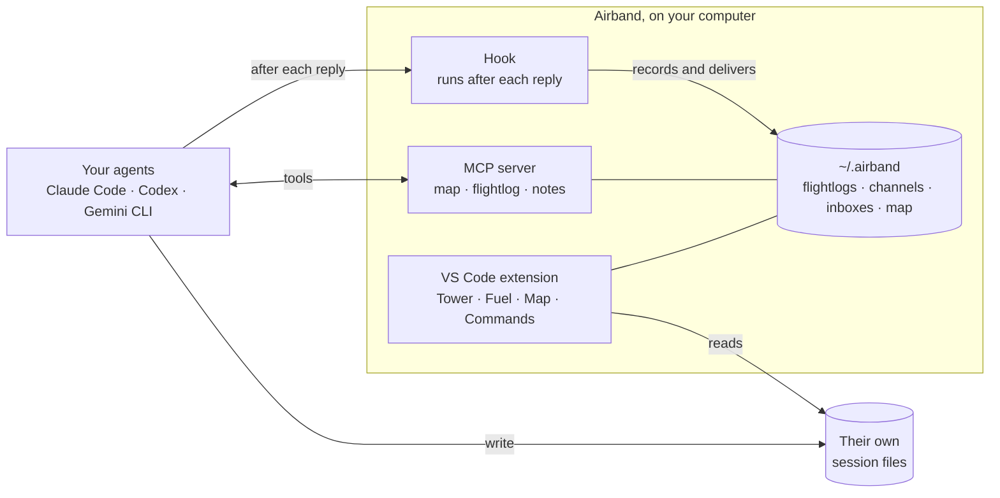
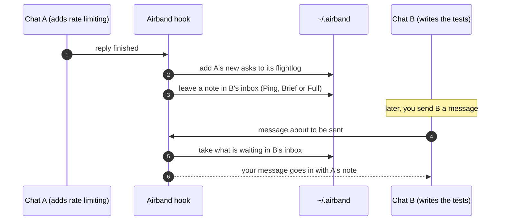
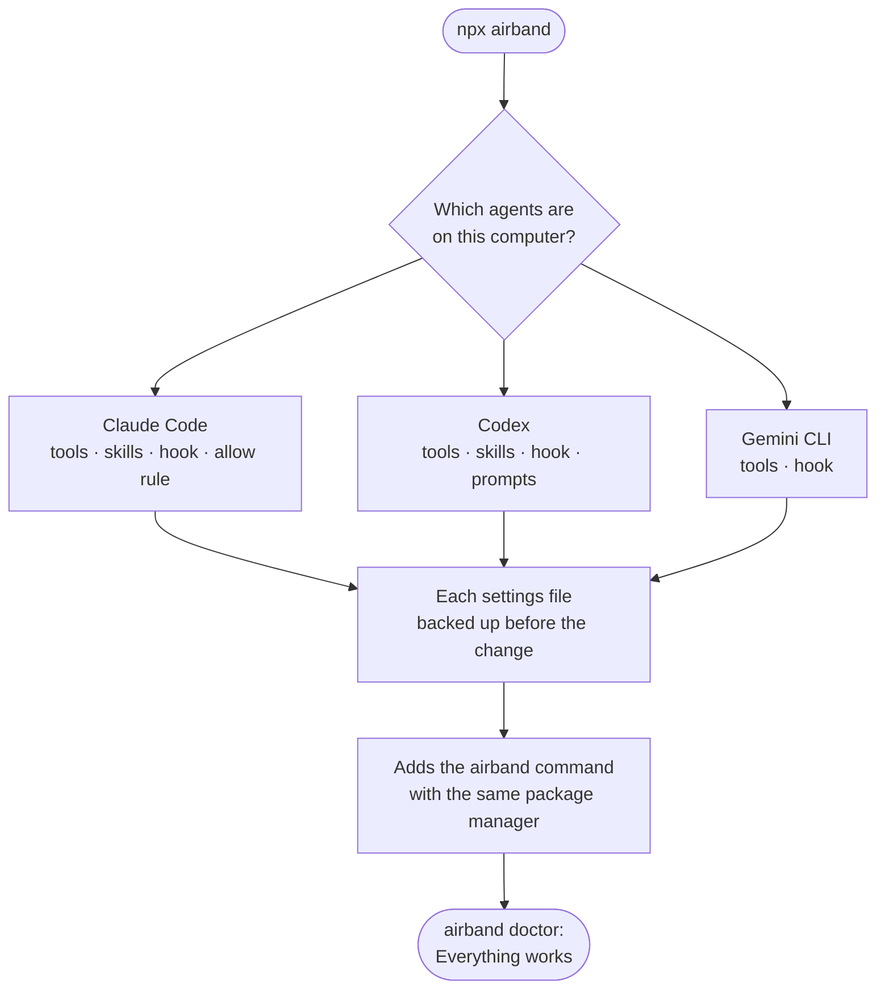

<h1 align="center">
  <picture>
    <source media="(prefers-color-scheme: dark)" srcset="media/airband-wordmark-dark.png">
    
  </picture>
</h1>

<p align="center">
  <strong>Connect your Claude Code, Codex and Gemini CLI chats, so each one knows what the others did.</strong>
</p>

<p align="center">
  <a href="https://github.com/HarshBaldaniya/airband/actions/workflows/test.yml"></a>
  <a href="https://www.npmjs.com/package/airband"></a>
  <a href="LICENSE"></a>
  
</p>

<p align="center">
  <a href="#quick-start">Quick start</a> ·
  <a href="#what-you-get">What you get</a> ·
  <a href="#how-it-works">How it works</a> ·
  <a href="#install">Install</a> ·
  <a href="#the-airband-command">Command line</a> ·
  <a href="#privacy-and-security">Privacy</a> ·
  <a href="#troubleshooting">Troubleshooting</a>
</p>

---

## Why Airband

You run several AI coding chats at once: one builds a feature, another writes its tests, a third reviews
the pull request. Each one starts blind to what the others just did, so you copy and paste between them,
or explain the same thing three times.

Airband links those chats. When a chat finishes a reply, every chat connected to it receives a short
note with its next message: what was asked, what was done and which files changed. It also gives every
agent a map of your code, so finding something costs a few hundred tokens instead of a search through
files.

- **Every agent, one place.** Claude Code, Codex and Gemini CLI, side by side in VS Code.
- **Chats that keep each other informed,** at the level of detail you choose.
- **Local by design.** No server, no account, no AI model of its own, and it never reads a login.

## Quick start

```bash
npx airband
```

That one command finds Claude Code, Codex and Gemini CLI on your computer, sets each one up, and
adds the `airband` command. Every settings file it touches is backed up first.

```text
  Airband 0.0.1  setting up your agents

  ✓ Claude Code   tools · skills · auto-sharing
  ✓ Codex         tools · skills · auto-sharing
  ✓ Gemini CLI    tools · auto-sharing
  ✓ airband       the command, in any new terminal

  Done. Restart open agent chats to pick it up.
```

Then restart your agent chats. In Codex, type `/hooks` once and trust Airband's hook: Codex runs a
new hook only after you approve it.

## What you get

| | |
|---|---|
| **Tower** | Every chat as a card on one board: its status, model, how full its context is. Drag one card onto another to **connect** them. |
| **Channels** | A connection between two chats, at the level you choose: **Ping** (one line per ask, the default), **Brief** (asked, done, open, files and PRs) or **Full** (the words themselves). One-way or both ways, paused or open. |
| **Flightlog** | A short record of each chat: one line per ask, with what was done, the files, commits and pull requests, and what is still open. |
| **Map** | Your project's parts and files as a board, built by a parser on your computer. Agents query it instead of searching files. TypeScript, JavaScript, Python, Go, Rust, Java, C#, Ruby and PHP. |
| **Commands** | 28 ready-made commands (plan, build, review, pr, tests, specs, recall and more), the same in every agent, plus your own as Markdown files. |
| **Fuel** | Each agent's plan limits as the agent reports them, and tokens per chat. |

### What your agents get

Setup gives each agent three tools over MCP (under 400 tokens of definitions in all), the
instructions to use them, and three skills they pick up by themselves when a task matches:

| Tool | What an agent does with it |
|---|---|
| `airband_map` | `find` code by name or meaning, ranked, with `path:start-end`; `outline` a file or folder; `graph` who uses what; `check` unused code and stale docs; or an overview of the project |
| `airband_flightlog` | Read another chat's asks and outcomes, or search every chat |
| `airband_notes` | Read and leave notes for the next chat in this project |

| Skill | Used when |
|---|---|
| `airband-find-code` | the agent needs to find where something is, or what uses it |
| `airband-recall` | you ask what was done before, or which chat changed something |
| `airband-catchup` | you ask what the other chats did while you were away |

The commands are there to run by hand too: `/airband:review` in Claude Code, `/prompts:review` in
Codex, `/review` in Gemini CLI.

## How it works

Airband sits beside your agents. It reads the session files they already write, keeps its own short
records, and reaches each agent through two standard doors every agent has: a **hook** that runs after
each reply, and an **MCP server** with the tools above.



### When two chats are connected



The note arrives with the next message you were sending anyway, so it costs no extra turn. The words
are fenced and marked as information from another chat, never as instructions.

### What `npx airband` does



Run it again any time: it changes nothing that is already right, and replaces only Airband's own
entries.

## Install

### The command line and every agent

| Package manager | Set up, nothing installed first | Install the command |
|---|---|---|
| npm | `npx airband` | `npm i -g airband` |
| pnpm | `pnpm dlx airband` | `pnpm add -g airband` |
| Yarn | `yarn dlx airband` | `yarn global add airband` (Yarn 1) |
| Bun | `bunx airband` | `bun add -g airband` |

**Requirements:** [Node.js](https://nodejs.org) 20 or newer, and at least one of Claude Code, Codex or
Gemini CLI. Works on macOS (Apple silicon and Intel), Windows 10 and 11, and Linux (x64 and Arm).
Nothing is compiled for your computer.

### VS Code extension

The Tower, Fuel, the Map and Commands live in the extension. It is not on the Marketplace yet;
install it from source:

```bash
git clone https://github.com/HarshBaldaniya/airband.git
cd airband
npm install
npm run install:vscode
```

Then reload VS Code (**Developer: Reload Window**). Needs VS Code 1.95 or newer.

### Claude Code plugin

```text
/plugin install airband --marketplace HarshBaldaniya/airband
```

### Gemini CLI extension

```bash
gemini extensions install https://github.com/HarshBaldaniya/airband --auto-update
```

## The airband command

| Command | What it does |
|---|---|
| `airband` | Show what each agent has, and set up anything missing |
| `airband doctor` | Check that everything works, with the exact fix for anything that doesn't |
| `airband update` | Move to the newest version and refresh every agent (`--check` only looks) |
| `airband remove` | Take Airband out of every agent (`--purge` also deletes its data) |
| `airband find "rate limiter"` | Where something is in your code; also `outline`, `graph`, `overview` |
| `airband changelog` | What changed in this version (`--all` for every version) |
| `airband about` | Version, system, where it is installed, and the links |
| `airband bug` | Open a GitHub issue with your version and system filled in |
| `airband help <command>` | Options and examples for any command |

`status`, `doctor`, `version` and `about` take `--json`. Setup takes `--agents claude,codex`,
`--no-sharing`, `--no-command`, `--completion` and `--verbose`.

<details>
<summary><strong>Tab completion</strong></summary>

Setup asks once whether to turn it on for zsh, bash or fish. For PowerShell, add
`airband completion powershell | Out-String | Invoke-Expression` to your `$PROFILE`.
`airband remove` takes it out again.
</details>

<details>
<summary><strong>Updates</strong></summary>

Airband checks npm for a newer version at most once a day and says so in one line; it never updates
by itself. The check is off in CI, and with `AIRBAND_NO_UPDATE_CHECK=1` or `NO_UPDATE_NOTIFIER=1`.
</details>

<details>
<summary><strong>The Map without VS Code</strong></summary>

For CI and cloud agents:

```bash
airband find "rate limiter"        # ranked matches, path:start-end
airband outline src/api/limits.ts  # one level of a file or folder
airband graph RateLimiter          # who uses it, what it uses
airband check docs                 # exits 1 when a doc names code that is gone
```

`--in <folder>` points it at another project. The parsers for TypeScript, JavaScript and Python are
built in; Go, Rust, Java, C#, Ruby and PHP are downloaded once, the first time a project has them,
and used only if they match a fingerprint built into Airband.
</details>

## Configuration

Settings live under **Settings → Extensions → Airband**:

| Setting | Default | What it does |
|---|---|---|
| `airband.contextSize` | `"standard"` | How much of a chat another chat receives when they are first connected: `compact` (~2k tokens), `standard` (~6k) or `full` (~15k). The rest is always in its flightlog. |
| `airband.autoDeliver` | `false` | Give waiting updates to a chat as soon as it finishes, at the cost of an extra turn. Off: they wait for your next message, at no extra cost. |
| `airband.codeMap.enabled` | `true` | Keep a Map of each open folder (about 1 MB for a large project). |
| `airband.backupFolder` | `""` | A folder to copy flightlogs and your own commands to every half hour, for example in iCloud Drive or Dropbox. |

<details>
<summary><strong>Keyboard shortcuts</strong></summary>

| Keys | Where | Action |
|---|---|---|
| `T` `U` `M` `C` | Everywhere | Tower, Fuel, Map, Commands |
| `/` | Tower, Map, Commands | Find a chat, a file or a command |
| `N` | Tower | New Claude chat |
| `1` `2` `3` `4` | Tower | Arrange by channel, time, agent, folder |
| `0` | Tower, Map | Fit everything in view |
| `F` | Tower, Fuel | Focus mode |
| `Esc` | Everywhere | Close, clear or step back |

Press `?` on any page for the full list.
</details>

## Privacy and security

- **Nothing is sent anywhere by Airband.** It reads the session files your agents already write and
  keeps its own data in `~/.airband`, readable only by you. No server, no account, no telemetry.
- **Online for two things only:** a daily npm version check, and a language parser the first time a
  project needs one. `AIRBAND_OFFLINE=1` turns both off.
- **Secrets stay out.** API keys, tokens and private keys pasted into a chat are removed before
  anything is recorded, shared or returned by a tool.
- **Shared text is data, not orders.** What one chat sends another is fenced with a random tag and
  marked as information, so words in it can't pass for your instructions.
- **No logins.** Airband never reads a login, token or key file.
- **Changes only Airband's own entries** in each agent's settings, after a backup; `airband remove`
  takes them all out again.

What one chat shares with another becomes part of the receiving chat, so it goes to that agent's
provider like anything else you type there. To report a vulnerability, see [SECURITY.md](SECURITY.md).

## Troubleshooting

<details>
<summary><strong>Start here: <code>airband doctor</code></strong></summary>

It checks Node.js, Airband's files, and for each agent the tools, the skills and auto-sharing, and
prints the exact fix for anything that isn't right.
</details>

<details>
<summary><strong>A connected chat doesn't receive updates</strong></summary>

Updates arrive with the chat's **next** message, not instantly (unless `airband.autoDeliver` is on).
Check that auto-sharing is on with `airband doctor`. In Codex, type `/hooks` once and trust Airband's
hook.
</details>

<details>
<summary><strong>The Map is empty or out of date</strong></summary>

Run **Airband: Read the code again for the map** in VS Code, or `airband map` in a terminal. The folder
needs code in one of the supported languages.
</details>

<details>
<summary><strong>Plan limits don't show for an agent</strong></summary>

Fuel shows only what each agent reports. Codex's limits come from its chat records, so they appear
after you have used Codex.
</details>

<details>
<summary><strong>Moving from Crosstalk</strong></summary>

Airband was called Crosstalk. `npx airband` moves a Crosstalk setup over by itself: its data, each
agent's tools, hooks, skills and commands, Tab completion, and the old `crosstalk` command.
</details>

## FAQ

**Does it cost tokens?** Notes between chats are short (Ping is one line per ask) and travel with
messages you were sending anyway. The agent tools add under 400 tokens of definitions.

**Which agents are supported?** Claude Code, Codex and Gemini CLI.

**Does it work in Cursor or Windsurf?** They are built on VS Code, so the extension should; they are not
tested yet. Reports are welcome.

**Do I need VS Code?** No. `npx airband` sets up the agents, the sharing and the tools on its own; the
extension adds the boards.

## Contributing

Issues and pull requests are welcome. [CONTRIBUTING.md](CONTRIBUTING.md) covers setup, how the code is
laid out and how releases work.

```bash
npm install
npm run typecheck
npm test      # never touches your real ~/.airband, ~/.claude, ~/.codex or ~/.gemini
```

## License

[MIT](LICENSE) © Harsh Baldaniya.

Airband depends on packages under their own licenses; one, the Claude Agent SDK, is under Anthropic's
terms. See [THIRD_PARTY_NOTICES.md](THIRD_PARTY_NOTICES.md).

Claude, Codex and Gemini are trademarks of their owners. Airband is an independent project, not
affiliated with or endorsed by them.
