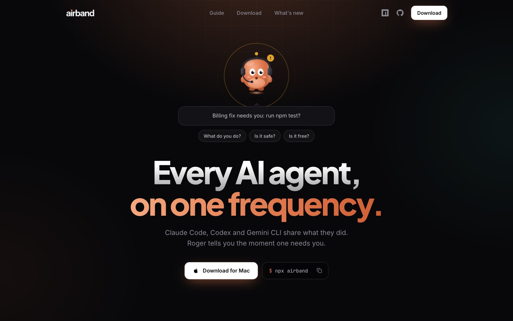

<h1 align="center">
  <picture>
    <source media="(prefers-color-scheme: dark)" srcset="media/airband-wordmark-dark.png">
    
  </picture>
</h1>

<p align="center">
  Connect your Claude Code, Codex and Gemini CLI chats, so each one knows what the others did.
</p>

<p align="center">
  <a href="https://github.com/HarshBaldaniya/airband/actions/workflows/test.yml"></a>
  <a href="https://www.npmjs.com/package/airband"></a>
  <a href="LICENSE"></a>
</p>

<p align="center">
  <a href="https://airband.harshbaldaniya.com">Website</a> ·
  <a href="https://airband.harshbaldaniya.com/download/">Download</a> ·
  <a href="#documentation">Documentation</a> ·
  <a href="CHANGELOG.md">Changelog</a>
</p>

<p align="center">
  
</p>

## Overview

You often run several AI coding chats at once: one builds a feature, another writes its tests, a third
reviews the pull request. Each one starts without knowing what the others did, so you copy and paste
between them, or explain the same thing again.

Airband links those chats. When a chat finishes a reply, every chat connected to it receives a short
note with its next message: what was asked, what was done and which files changed. It also gives every
agent a map of your code, so finding something costs a few hundred tokens instead of a search through
files.

- **Every agent, one place.** Claude Code, Codex and Gemini CLI, on macOS, Windows and Linux.
- **Chats that keep each other informed,** at the level of detail you choose.
- **Roger, a desktop companion** (about 3 MB) that shows when a chat needs you and what a finished
  chat did, with alerts on your iPhone from a Mac.
- **Local by design.** No server, no account, no AI model of its own, and it never reads a login.

## Install

**Desktop app** (Mac and Windows). One line installs it and opens it:

```bash
curl -fsSL https://airband.harshbaldaniya.com/install.sh | sh          # Mac, in Terminal
irm https://airband.harshbaldaniya.com/install.ps1 | iex               # Windows, in PowerShell
```

Or download it from the [website](https://airband.harshbaldaniya.com/download/). The first start
sets up every agent it finds. See [The desktop app](docs/desktop-app.md).

**Command line** (any computer with [Node.js](https://nodejs.org) 20 or newer):

```bash
npx airband
```

It finds Claude Code, Codex and Gemini CLI, sets each one up, and adds the `airband` command. Every
settings file it touches is backed up first. Then restart your agent chats. In Codex, type `/hooks`
once and trust Airband's hooks: Codex runs a new hook only after you approve it, and `airband doctor`
tells you when it skips one.

| Package manager | Set up, nothing installed first | Install the command |
|---|---|---|
| npm | `npx airband` | `npm i -g airband` |
| pnpm | `pnpm dlx airband` | `pnpm add -g airband` |
| Yarn | `yarn dlx airband` | `yarn global add airband` (Yarn 1) |
| Bun | `bunx airband` | `bun add -g airband` |

**Inside your tools:**

| Tool | Install |
|---|---|
| Claude Code plugin | `/plugin install airband --marketplace HarshBaldaniya/airband` |
| Gemini CLI extension | `gemini extensions install https://github.com/HarshBaldaniya/airband --auto-update` |
| VS Code extension | Download `airband-<version>.vsix` from the [latest release](https://github.com/HarshBaldaniya/airband/releases/latest), then **Extensions → … → Install from VSIX**. Needs VS Code 1.95 or newer. |

## What you see

Each new chat opens with a line from Airband, shown to you only:

```text
✓ Airband · map of my-app ready (1,284 files) · sharing with “Billing fix” (Codex)
  Another chat worked here in the last 12 hours: “Fix login redirect” (Codex). Say “catch up” to hear what it did.
```

When another chat's work rides along with your message:

```text
↪ Airband added what “Billing fix” (Codex) did to this message
```

And after an agent asks Airband something, what it found and what it saved:

```text
↪ Airband: “syncSeats” and the 4 places that use it · about 300 tokens instead of about 9,800 to read the 5 files
```

The saving is measured, not guessed: the answer's own length against the real size of the files it
points to. It shows only when it is a real saving.

## Features

| | |
|---|---|
| **Channels** | Connect two chats at the level you choose: **Ping** (one line per ask, the default), **Brief** or **Full**. One way or both ways, paused or open. |
| **Flightlog** | A short record of each chat: what was asked and done, the files, commits and pull requests, and what is still open. |
| **Map** | Your project's code as a map, built on your computer. Agents query it instead of searching files. TypeScript, JavaScript, Python, Go, Rust, Java, C#, Ruby and PHP. |
| **Agent tools and skills** | Three MCP tools (under 400 tokens of definitions) and 15 skills agents use by themselves: review a PR, plan tests, debug, hand off, write a standup and more. |
| **Writing rules** | Short house rules when an agent writes a doc or a message, and a check of what it wrote. |
| **Roger** | The desktop companion: requests, questions and finished chats in a corner of your screen and on your iPhone. A chat running many agents is one chat, working until its last agent ends. |
| **VS Code boards** | The Tower (every chat as a card), Fuel (plan limits and tokens), the Map and Commands. |

## Documentation

| Guide | What it covers |
|---|---|
| [How it works](docs/how-it-works.md) | The hook, the MCP server, and what happens when two chats are connected |
| [What your agents get](docs/agents.md) | The tools and skills, reviewing a pull request, tickets, standups and AI spend |
| [The desktop app](docs/desktop-app.md) | Download, the setup tour, Roger, your iPhone, files and uninstalling |
| [Writing rules](docs/writing.md) | The docs and message rules, the checks, and a team's own rules |
| [The airband command and settings](docs/cli.md) | Every command, configuration, updates and keyboard shortcuts |
| [Privacy and security](docs/privacy.md) | What stays on your computer and what goes online |
| [Troubleshooting and FAQ](docs/troubleshooting.md) | `airband doctor`, common problems and questions |

## Privacy

- **Nothing is sent anywhere by Airband,** unless you link an iPhone. It reads the session files your
  agents already write and keeps its own data in `~/.airband`, readable only by you.
- **No account, no telemetry, no logins.** It never reads a login, token or key file, and secrets
  pasted into a chat are removed before anything is recorded or shared.
- **The iPhone link is locked end to end.** The relay that carries it can't read it.
- **Shared text is data, not orders.** What one chat sends another is fenced and marked as
  information, so words in it can't pass for your instructions.

The full list is in [Privacy and security](docs/privacy.md). To report a vulnerability, see
[SECURITY.md](SECURITY.md).

## Contributing

Issues and pull requests are welcome. [CONTRIBUTING.md](CONTRIBUTING.md) covers the setup, how a
change reaches `main` (a reviewed pull request, with the tests passing), how the repository is laid
out and how releases work.

```bash
npm install
npm run typecheck
npm test      # never touches your real ~/.airband, ~/.claude, ~/.codex or ~/.gemini
```

## License

[MIT](LICENSE) © Harsh Baldaniya.

Airband depends on packages under their own licenses; one, the Claude Agent SDK, is under Anthropic's
terms. See [THIRD_PARTY_NOTICES.md](THIRD_PARTY_NOTICES.md).

Claude, Codex and Gemini are trademarks of their owners. Airband is an independent project, not
affiliated with or endorsed by them.
