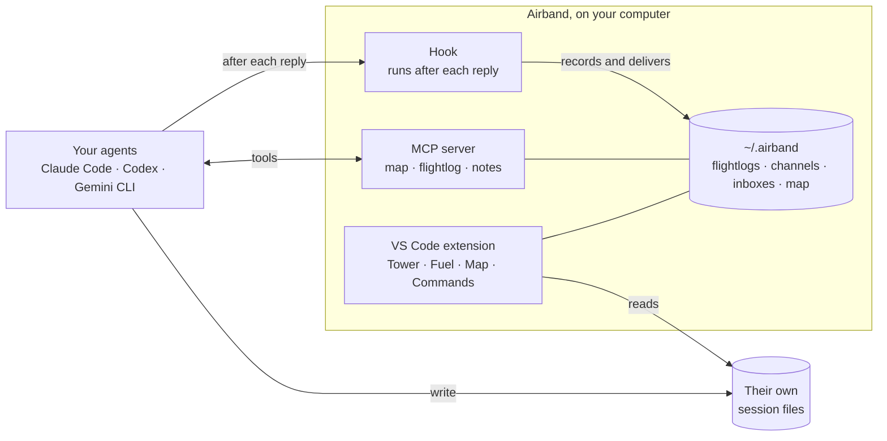
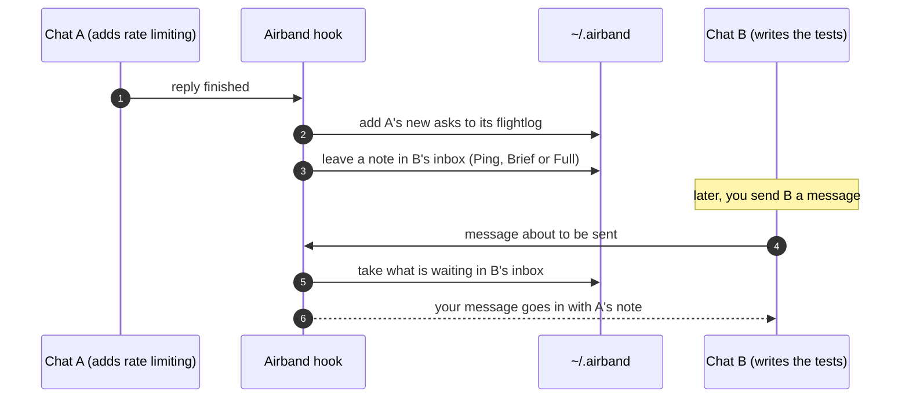
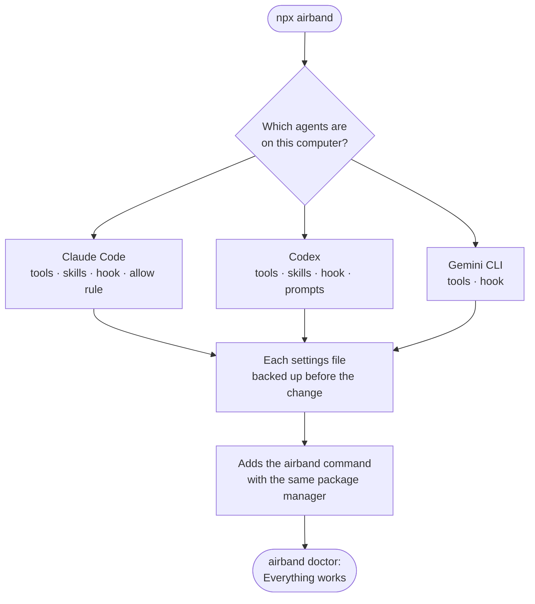

[← Airband](../README.md)

# How it works

Airband runs on your computer, next to your agents. It has no server and no account.

Airband sits beside your agents. It reads the session files they already write, keeps its own short
records, and reaches each agent through two standard doors every agent has: a **hook** that runs after
each reply, and an **MCP server** with the tools above.

## When two chats are connected

The note arrives with the next message you were sending anyway, so it costs no extra turn. The words
are fenced and marked as information from another chat, never as instructions.

## What `npx airband` does

Run it again any time: it changes nothing that is already right, and replaces only Airband's own
entries.
